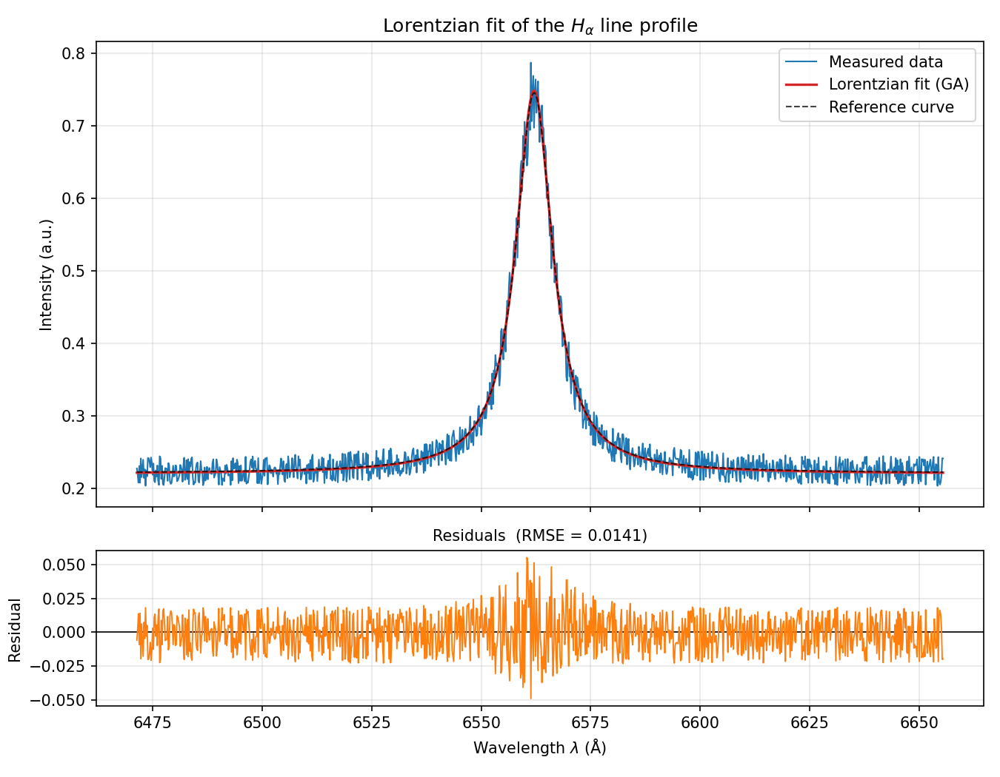
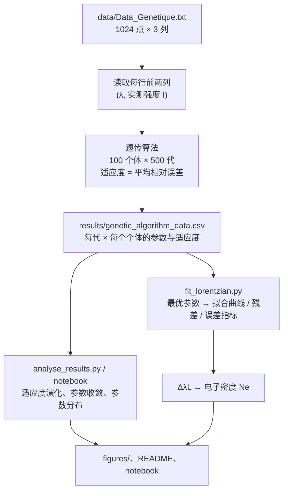
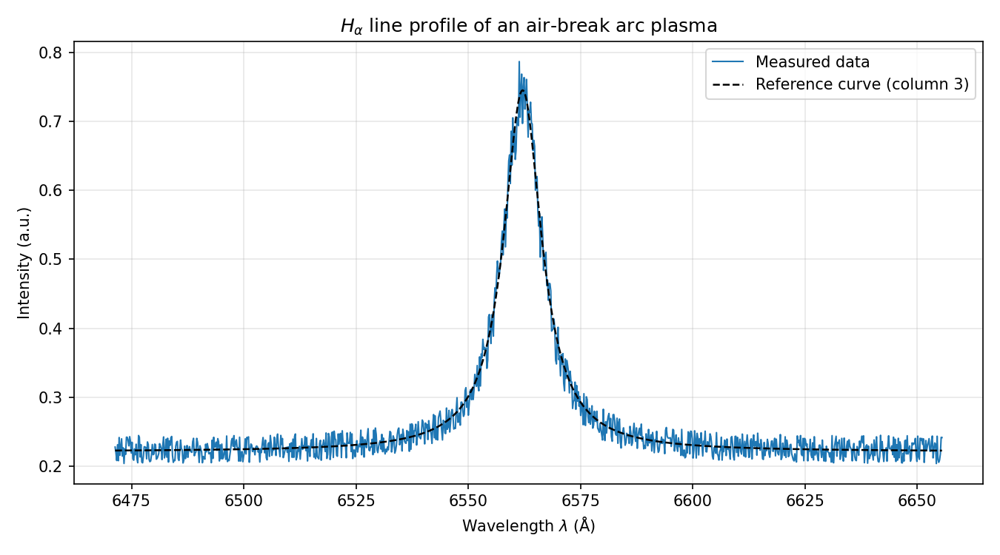
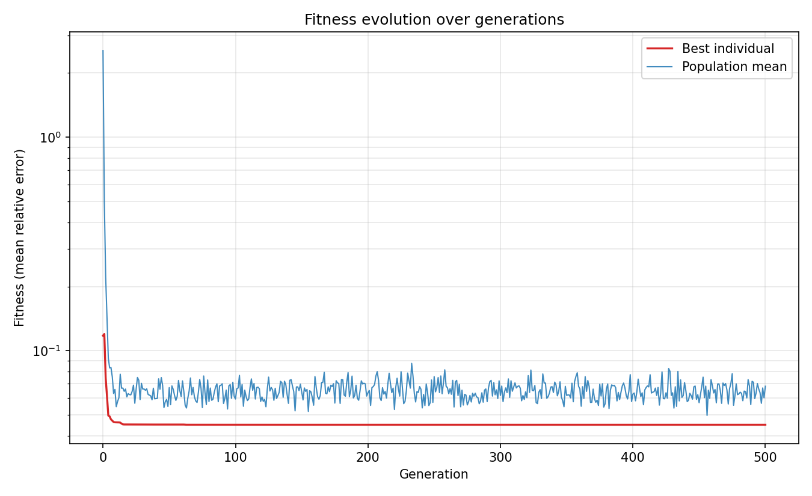
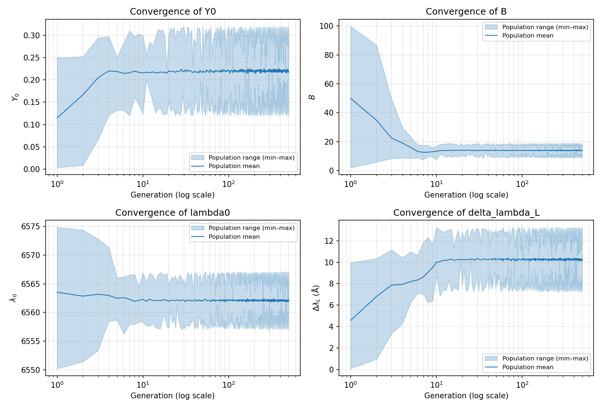
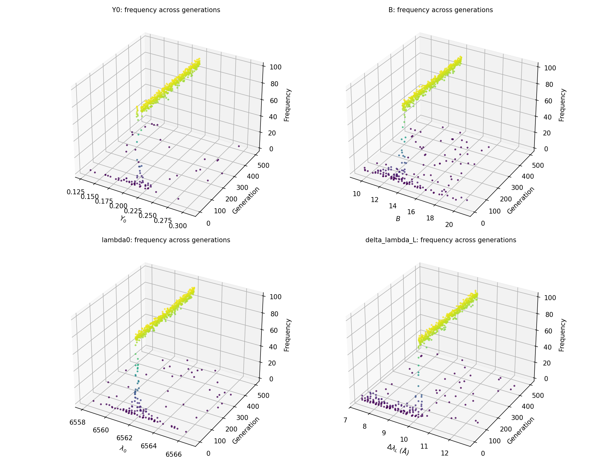

# LorentzGA · 基于遗传算法的 Hα 谱线洛伦兹拟合

*Lorentzian fitting of the Hα line profile with a genetic algorithm*

> 空气断路器电弧等离子体电子密度的光谱诊断
> 课程项目整理版（Projet numérique niveau 2）· Université Toulouse III — Paul Sabatier / Northeastern University · 2024 年 12 月



## 项目简介

在空气断路器（disjoncteur à air）中，切断故障电流时触头分离会产生高温电弧——一种热等离子体。空气中的水分子在电弧中分解出氢原子，其 **Hα 谱线**（约 6562 Å）的轮廓形状与等离子体的电子密度直接相关。因此，通过对电弧光谱做谱线拟合，可以反演出电子密度，为断路器的灭弧设计与状态诊断提供依据。

本项目要解决的问题是：给定一条实测的 Hα 谱线（1024 个采样点），寻找洛伦兹函数

$$
J(\lambda) = Y_0 + \frac{B}{(\lambda-\lambda_0)^2 + \left(\dfrac{\Delta\lambda_L}{2}\right)^2}
$$

的四个参数，使拟合曲线尽可能贴近测量数据；再由拟合得到的半高全宽 $\Delta\lambda_L$ 反演电子密度：

$$
\log_{10}(n_e) = 21.78515 + 1.2614 \cdot \log_{10}(\Delta\lambda_L)
$$

其中 $n_e$ 的单位为 $\mathrm{m^{-3}}$，$\Delta\lambda_L$ 的单位为 Å。

| 参数 | 含义 | 参考值（拟合结果） |
| --- | --- | --- |
| $Y_0$ | 谱线基线（背景强度） | 0.2199 |
| $B$ | 谱线幅度 | 13.91 |
| $\lambda_0$ | 谱线中心波长 | 6562.077 Å |
| $\Delta\lambda_L$ | 半高全宽（FWHM） | 10.257 Å |

优化方法采用**遗传算法**：不依赖初值、不需要计算梯度，适合在这类参数耦合较强的非线性拟合中搜索全局最优。

## 项目流程

从原始数据到电子密度的完整链路（每一步的输入、操作与中间数值详见 [`docs/pipeline.md`](docs/pipeline.md)）：



## 数据集

| 文件 | 说明 |
| --- | --- |
| [`data/Data_Genetique.txt`](data/Data_Genetique.txt) | 主数据：1024 行 × 3 列，依次为波长（Å）、实测强度（任意单位）、无噪声参考曲线 |
| [`data/lorentzian_synthetic.txt`](data/lorentzian_synthetic.txt) | 101 点合成洛伦兹曲线，可用于快速自检 |

- 波长范围 6471.35–6655.49 Å，步长约 0.18 Å；
- **程序只使用每行的前两列**（波长、实测强度）参与拟合；
- 第三列是噪声-free 的参考曲线，本仓库的 `fit_lorentzian.py` 用它评估拟合质量（不参与优化）。



## 算法设计

遗传算法把"参数"编码为"基因"，让一群候选解在"选择—交叉—变异"的循环中逐代进化。

| 要素 | 设置 |
| --- | --- |
| 基因 | 洛伦兹函数的 4 个参数 $[Y_0, B, \lambda_0, \Delta\lambda_L]$ |
| 个体 | 一个 4 维实数向量，即一组待拟合参数 |
| 种群 | 每代 100 个个体 |
| 适应度 | 逐点相对误差的平均值 $\displaystyle \frac{1}{N}\sum_i \frac{|J(\lambda_i)-I_i|}{|I_i|}$（越小越好） |
| 选择 | 锦标赛选择，每轮随机抽 5 个个体取最优 |
| 交叉 | 算术交叉：对每个基因独立生成权重 $\alpha \sim U(0,1)$，子代 $= \alpha P_1 + (1-\alpha)P_2$ |
| 变异 | 每个基因以 10% 概率叠加一个均匀分布的随机扰动 |
| 终止条件 | 迭代 500 代 |
| 搜索范围 | $Y_0\in[0,0.25]$，$B\in[1,100]$，$\lambda_0\in[6550,6575]$ Å，$\Delta\lambda_L\in[0,10]$ Å |
| 随机种子 | 12345（固定种子，结果可复现） |

**关于适应度的选择**：项目报告对比了均方误差（MSE）、归一化均方误差（NMSE）、平均绝对误差（MAE）和平均相对误差（MRE）四种适应度。实测噪声的幅度随信号增大（峰顶附近的残差明显大于基线），因此采用对幅度不敏感的**相对误差**，使谱线两翼也参与约束。

## 快速开始

### 环境依赖

- **C 版**：GCC 或 MSVC（任意 C99 编译器即可）
- **Python 版**：Python ≥ 3.9，依赖见 [`requirements.txt`](requirements.txt)（numpy / pandas / matplotlib / scipy）
- **Notebook**：Jupyter（可选，用于交互式分析）

### 1. 运行 C 版（参考实现）

```bash
# Linux / macOS
gcc -O2 -o genetic_algorithm src/c/genetic_algorithm.c -lm
mkdir -p results
./genetic_algorithm data/Data_Genetique.txt results/genetic_algorithm_data.csv
```

```bat
:: Windows + MSVC（在 "x64 Native Tools Command Prompt" 中执行）
cl /O2 src\c\genetic_algorithm.c
if not exist results mkdir results
genetic_algorithm.exe data\Data_Genetique.txt results\genetic_algorithm_data.csv
```

程序会把**每一代、每一个个体**的参数与适应度写入 CSV，并在结束时打印最优参数、电子密度和误差指标。500 代 × 100 个体约 0.3 s 跑完。

### 2. 运行 Python 版

```bash
python src/python/ga_lorentzian.py
```

算法设置与 C 版完全一致（随机数序列不同），结果写入 `results/genetic_algorithm_data.csv`。

### 3. 分析结果与作图

```bash
python src/python/analyse_results.py   # 适应度演化、参数收敛、参数分布
python src/python/fit_lorentzian.py    # 拟合曲线、残差、误差指标、电子密度
```

图片输出到 `figures/`，文字摘要输出到 `results/run_summary.txt`。

### 4. 交互式分析（可选）

[`notebooks/analyse_genetique.ipynb`](notebooks/analyse_genetique.ipynb) 对运行输出做可视化分析（需先生成 `results/genetic_algorithm_data.csv`）。

## 结果

参考运行：C 版，`RANDOM_SEED = 12345`。表中"参考曲线"是对数据第三列（无噪声曲线）做最小二乘拟合得到的参数。本节图片均由修正后的运行生成；整理前（旧数据读取方式）的图见 [`notebooks/archive/`](notebooks/archive/README.md)。

| 参数 | 遗传算法拟合 | 参考曲线 | 相对偏差 |
| --- | --- | --- | --- |
| $Y_0$ | 0.21992 | 0.22076 | −0.38 % |
| $B$ | 13.907 | 13.864 | +0.31 % |
| $\lambda_0$ | 6562.077 Å | 6562.096 Å | −0.00 % |
| $\Delta\lambda_L$ | 10.257 Å | 10.279 Å | −0.21 % |
| **电子密度 $n_e$** | **1.149 × 10²³ m⁻³** | 1.152 × 10²³ m⁻³ | −0.27 % |

拟合误差（对 1024 个实测点）：MAE = 0.0117，RMSE = 0.0141，NMSE = 0.0194，平均相对误差 = **4.50 %**。

Python 版（同一种子）得到平均相对误差 4.51 %、$\Delta\lambda_L$ = 10.020 Å、$n_e$ = 1.116 × 10²³ m⁻³——与 C 版的最优适应度几乎相同，参数差异在 4 % 以内（该方向上适应度面较平坦）。

### 适应度演化



前 10–20 代平均适应度就从 2.5 降到 0.06 左右；最优适应度在第 62 代达到 0.0451，此后基本不变，主要靠变异做局部搜索。

### 参数收敛过程



实线为种群均值，阴影为当前代的取值范围（最小—最大）。均值很快收敛，但种群仍保持一定宽度——这是固定变异幅度带来的持续扰动。

### 参数在每一代中的分布



X 轴为参数值，Y 轴为代数，Z 轴为该区间内的个体数。算法前期个体散布在整个搜索空间，随着代数增加，绝大部分个体聚集到最优值附近。

### 关于结果的几点讨论

- 拟合参数与数据第三列对应的参考参数相差不到 0.5 %，说明遗传算法确实找到了正确的洛伦兹轮廓；
- 最优个体的参数收敛很快，但种群不会"塌缩"到一个点：固定变异幅度保证了多样性（避免早熟），代价是后期难以精细收敛。若需要更高精度，可以加入精英保留（elitism）或自适应变异幅度，或对最后若干代做局部优化；
- 该问题只有 4 个参数，也可以用 Levenberg–Marquardt 等梯度方法求解；本项目采用遗传算法是课程要求，同时也展示了无梯度方法在这类拟合问题上的可行性。

## 项目结构

```
LorentzGA/
├── README.md
├── requirements.txt
├── .gitignore
├── .gitattributes
├── data/
│   ├── Data_Genetique.txt          # 实验数据（波长、实测强度、参考曲线）
│   └── lorentzian_synthetic.txt    # 合成洛伦兹曲线（快速自检用）
├── src/
│   ├── c/
│   │   └── genetic_algorithm.c     # C 版遗传算法（参考实现）
│   └── python/
│       ├── ga_lorentzian.py        # Python 版遗传算法（与 C 版逻辑一致）
│       ├── analyse_results.py      # 适应度 / 参数收敛 / 参数分布作图
│       └── fit_lorentzian.py       # 拟合曲线、残差、误差指标与电子密度
├── notebooks/
│   ├── analyse_genetique.ipynb     # 当前分析（修正后数据，已执行）
│   └── archive/
│       ├── README.md               # 存档说明
│       └── analyse_genetique_original.ipynb  # 整理前分析（含当时的图）
├── figures/                        # README 与分析脚本生成的图片
├── results/                        # 运行输出（CSV、摘要，已被 .gitignore 忽略）
└── docs/
    ├── pipeline.md                 # 项目流程详解（从原始数据到结果）
    ├── sujet-projet-niveau-2.pdf   # 课程题目说明（法语）
    ├── rapport.pdf                 # 项目报告（法语）
    └── presentation.pdf            # 答辩幻灯片（法语）
```

## 关于原始版本与本次整理

本项目最初是课程作业，原始文件分散在 C 工程与若干 Jupyter notebook 中。整理为 Git 仓库时做了如下修改：

1. **修正数据读取**。原始 C 版用 `fscanf("%lf %lf", ...)` 连续读取数字。当数据文件每行有三列时，它会将"第三列 + 下一行第一列"配成一对，导致数据整体错位；原始报告中基于运行输出绘制的适应度曲线（数值约 0.38）即受此影响。现在改为逐行读取，只取每行前两个数。
2. **固定随机种子**（`RANDOM_SEED = 12345`），使结果可复现。原版把 `srand(time(NULL))` 注释掉了：每次运行结果相同，但不同编译器/平台的 `rand()` 序列可能不同，跨平台仍不能保证复现。
3. **工程化改造**：支持命令行指定数据/输出路径、动态分配内存、输出误差指标、增加 Python 等价实现与分析脚本。
4. 用修正后的代码重新运行，生成本 README 中的全部图片。
5. **整理前的分析 notebook 原样存档**在 [`notebooks/archive/`](notebooks/archive/README.md)（含当时基于旧数据的图），与当前 notebook 并存，便于对照；存档版不可直接运行（数据路径指向原作者本地目录，旧 CSV 未纳入仓库）。

修正数据读取后，最优参数与数据第三列（参考曲线）一致（偏差 < 0.5 %）；而错位版本得到的 $\Delta\lambda_L \approx 9.38$ Å，比参考值偏低约 9 %，对应的电子密度也偏低约 11 %。这说明"把数据读对"对反演结果至关重要。

## 文档与报告

| 文件 | 内容 |
| --- | --- |
| [`docs/sujet-projet-niveau-2.pdf`](docs/sujet-projet-niveau-2.pdf) | 课程题目说明（法语，原作者 P. Freton, UT3） |
| [`docs/rapport.pdf`](docs/rapport.pdf) | 项目报告：背景、算法、代码架构与结果分析（法语） |
| [`docs/presentation.pdf`](docs/presentation.pdf) | 答辩幻灯片（法语） |

## 作者与致谢

- **QIAN Boda** — 遗传算法设计与实现、测试与参数优化、结果分析
- **QIN Chaofan** — 数据处理、算法实现协作、报告撰写

课程项目：Projet numérique niveau 2（TP 41），Université Toulouse III — Paul Sabatier 与 Northeastern University 联合培养项目，2024 年 12 月。

参考书目：

- Haupt Randy L., Haupt Sue Ellen, *Practical Genetic Algorithms*, John Wiley & Sons, 2004.
- Ouahib Guenounou, *Méthodologie de conception de contrôleurs intelligents par l'approche génétique — application à un bioprocédé*, thèse de l'Université Paul Sabatier Toulouse, 2009.

## 版权说明

本项目为课程作业作品，代码可供学习参考；报告、幻灯片与数据来自课程作业，版权归原作者所有，未经许可请勿转载。
