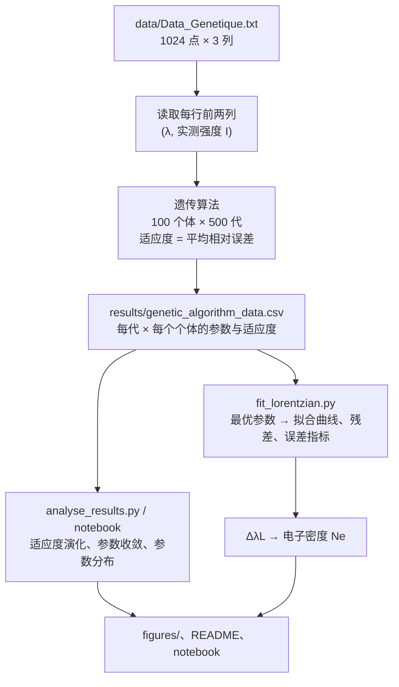

# 项目流程：从原始数据到结果

本文把整个项目从头到尾走一遍：每一步的输入、输出、具体操作和关键数值。代码位置都在仓库
根目录的相对路径下；所有数字都来自仓库内的参考运行（C 版，`RANDOM_SEED = 12345`）。



---

## 第 0 步：原始数据

文件：[`data/Data_Genetique.txt`](../data/Data_Genetique.txt)，**1024 行 × 3 列**（空格分隔）：

| 列 | 内容 | 说明 |
| --- | --- | --- |
| 1 | 波长 λ（Å） | 6471.35 – 6655.49 Å，步长约 0.18 Å |
| 2 | 实测强度 I（任意单位） | 谱线峰在 6562 Å 附近，峰值约 0.78，基线约 0.22 |
| 3 | 参考曲线 | 一条**无噪声**的洛伦兹曲线，拟合残差约 3×10⁻⁷，可视为“真值” |

第三列不参与优化，只用来最终评估拟合质量（我们是在整理阶段确认它是一条理想洛伦兹曲线）。
实测强度与参考曲线之差就是测量噪声：

- 全谱噪声标准差 ≈ 0.0141，最大偏差 ≈ 0.052；
- 基线区（|λ−6562| > 50 Å）噪声标准差 ≈ 0.0118，峰顶附近（|λ−6562| < 5 Å）≈ 0.0265
  —— **噪声幅度随信号增大**，这一点决定了适应度应该怎么选（见第 2 步）。

图：[`figures/data_overview.png`](../figures/data_overview.png)

## 第 1 步：数据读取（整理时修正的一步）

程序只需要每行的前两个数 (λ, I)。

原始 C 版的写法是连续调用 `fscanf("%lf %lf")` 读数字。当文件每行有 3 列时，数字流的配对会变成：

```
正确: (λ₁, I₁)  错位: (参考₁, λ₂)  错位: (I₂, 参考₂)  正确: (λ₃, I₃) ...
```

即每 3 对里只有 1 对是真实的“波长—强度”，另外 2 对是错配的；数据点数也会从 1024 变成 1536。
后果很直接：适应度被人为抬高到约 0.38，最优参数被带偏。

整理版改为**逐行读取，只取每行前两个数**（C 里 `fgets` + `sscanf`，Python 里 `np.loadtxt(usecols=(0,1))`），
并且支持动态数组（不预设点数）。

|  | 旧版（连续 fscanf） | 整理版（逐行读前两列） | 参考曲线 |
| --- | --- | --- | --- |
| 参与拟合的点数 | 1536（错配） | 1024（正确） | — |
| 适应度平台（平均相对误差） | ≈ 0.38 | **0.0450** | — |
| 最优 ΔλL | ≈ 9.4 Å | **10.257 Å** | 10.279 Å |
| 电子密度 Ne | ≈ 1.0 × 10²³ m⁻³ | **1.149 × 10²³ m⁻³** | 1.152 × 10²³ m⁻³ |

> 数据本身没有做平滑、插值或归一化；对数据的唯一“处理”就是读对每一行。

## 第 2 步：模型与适应度函数

待拟合的洛伦兹函数：

$$
J(\lambda) = Y_0 + \frac{B}{(\lambda-\lambda_0)^2 + (\Delta\lambda_L/2)^2}
$$

未知量为 4 个参数：基线 $Y_0$、幅度 $B$、中心波长 $\lambda_0$、半高全宽 $\Delta\lambda_L$。

适应度取**逐点相对误差的平均值**（越小越好）：

$$
f = \frac{1}{N}\sum_{i=1}^{N}\frac{|J(\lambda_i)-I_i|}{|I_i|}
$$

项目报告对比了四种误差（MSE、NMSE、MAE、MRE），最终选相对误差，原因与第 0 步的噪声特征一致：
噪声幅度随信号增大，用相对误差相当于把峰顶（大信号、大噪声）和两翼（小信号、小噪声）放到
相近的权重上，避免拟合被峰顶少数点主导。

## 第 3 步：遗传算法的具体设置

| 要素 | 设置 |
| --- | --- |
| 基因 / 个体 | 4 个实数参数组成的向量 |
| 种群 | 100 个个体，初代在参数范围内均匀随机生成 |
| 搜索范围 | $Y_0\in[0,0.25]$，$B\in[1,100]$，$\lambda_0\in[6550,6575]$ Å，$\Delta\lambda_L\in[0,10]$ Å |
| 选择 | 锦标赛选择：每次随机抽 5 个个体，取适应度最小者作为父代 |
| 交叉 | 算术交叉：对每个基因独立取 $\alpha\sim U(0,1)$，子代 $=\alpha P_1+(1-\alpha)P_2$（必做，无交叉概率） |
| 变异 | 每个基因以 0.1 的概率叠加均匀扰动：$Y_0\pm0.1$、$B\pm5$、$\lambda_0\pm5$、$\Delta\lambda_L\pm3$ |
| 终止 | 迭代 500 代 |
| 随机种子 | 12345（固定，结果可复现） |
| 精英保留 | 无（靠选择压力让好个体保持优势） |

每一代实际执行的循环（C 版 `main` 与 Python 版 `run_ga` 一致）：

```
记录当前代种群与适应度 → 写 CSV
重复 50 次（每次产生 2 个子代）：
    锦标赛选父代 p1, p2
    算术交叉得到 child1, child2
    对 child1、child2 逐基因变异
    替换下一代种群
对新一代 100 个个体重新计算适应度
```

## 第 4 步：运行与输出

**C 版（参考实现）**

```bash
cl /O2 src/c/genetic_algorithm.c        # 或 gcc -O2 ... -lm
genetic_algorithm.exe data\Data_Genetique.txt results\genetic_algorithm_data.csv
```

- 运行时间：约 0.3 s（500 代 × 100 个体 × 1024 点）；
- 输出 CSV 共 50 100 行（第 0–500 代 × 每代 100 个体），列为
  `Generation,Individual,Y0,B,lambda0,delta_lambda_L,Fitness`；
- 同时打印最优参数、电子密度和误差指标。

**Python 版**（`src/python/ga_lorentzian.py`）采用完全相同的设置，运行约 1.5 s；
随机序列不同，因此最优参数会有微小差别（见第 6 步）。

## 第 5 步：结果

参考运行的最优个体（整轮运行中出现过的最小适应度，出现在第 392 代，最终一代仍保留）：

| 参数 | 拟合值 | 参考曲线（数据第 3 列最小二乘） | 相对偏差 |
| --- | --- | --- | --- |
| $Y_0$ | 0.21992 | 0.22076 | −0.38 % |
| $B$ | 13.907 | 13.864 | +0.31 % |
| $\lambda_0$ | 6562.077 Å | 6562.096 Å | −0.00 % |
| $\Delta\lambda_L$ | 10.257 Å | 10.279 Å | −0.21 % |
| **电子密度 $n_e$** | **1.149 × 10²³ m⁻³** | 1.152 × 10²³ m⁻³ | −0.27 % |

误差指标（对 1024 个实测点）：MAE = 0.0117，RMSE = 0.0141，NMSE = 0.0194，平均相对误差 = 4.50 %。

电子密度由拟合出的半高宽换算：

$$
\log_{10}(n_e) = 21.78515 + 1.2614\log_{10}(\Delta\lambda_L)
$$

## 第 6 步：分析与验证

从 CSV 里能直接看到算法的行为：

| 代数 | 最优适应度 | 平均适应度 |
| --- | --- | --- |
| 0 | 0.118 | 2.547 |
| 5 | 0.0493 | 0.083 |
| 10 | 0.0462 | 0.0548 |
| 20 | 0.0452 | 0.0624 |
| 62 | 0.0451（首次达到） | — |
| 392 | **0.04505（历史最优）** | — |
| 500 | 0.04505 | 0.068 |

- **收敛很快**：前 10–20 代就把平均适应度从 2.5 降到 0.06 左右；第 62 代达到 0.0451，之后基本不变。
- **种群没有完全塌缩**：第 500 代时，88 %（$Y_0$）、93 %（$B$）、100 %（$\lambda_0$）、90 %（$\Delta\lambda_L$）
  的个体仍在最优值 ±1 % 内；其余个体是固定幅度变异带来的探索。
- **拟合残差**是零均值的噪声，RMSE = 0.0141，与测量噪声量级一致——说明模型已经把信号全部解释了。
- **独立实现交叉验证**：Python 版同样收敛到 0.0451 附近（MRE 4.51 %，
  $Y_0=0.22053$、$B=13.380$、$\lambda_0=6562.048$ Å、$\Delta\lambda_L=10.020$ Å、$n_e=1.116\times10^{23}$ m⁻³），
  与 C 版差异在 4 % 以内，说明结果不是某一次实现的偶然。

**局限与可改进的地方**：没有精英保留（本次运行中历史最优恰好留到了最后，但不保证每次）；
变异幅度固定且较大，后期无法精细收敛；变异后参数可能越出搜索范围（没有做边界投影）；
若追求更高精度，可以加精英保留、自适应/递减变异幅度，或对最后结果做一次梯度/LM 局部优化。

## 第 7 步：落盘的东西

| 产物 | 位置 | 内容 |
| --- | --- | --- |
| 遗传算法输出 | `results/genetic_algorithm_data.csv`（已被 .gitignore 忽略） | 第 0–500 代每个个体的参数与适应度 |
| 运行摘要 | `results/run_summary.txt`（忽略） | 最优参数、误差指标、与参考曲线对比 |
| 拟合曲线与残差 | `figures/fit_lorentzian.png` | 实测谱线、拟合曲线、参考曲线、残差 |
| 适应度演化 | `figures/fitness_evolution.png` | 每代最优/平均适应度（对数纵轴） |
| 参数收敛 | `figures/parameter_convergence.png`、`figures/parameter_spread.png` | 每代最优参数、参数取值范围（min–max） |
| 参数分布 | `figures/parameter_distribution_3d.png` | 参数值 × 代数 × 出现次数 |
| 交互分析 | `notebooks/analyse_genetique.ipynb` | 以上分析的 notebook 版本（已执行） |
| 旧版分析存档 | `notebooks/archive/` | 整理前的 notebook（基于旧数据，含当时的图） |

## 附：2026-11-16 重构记录

1. **修正数据读取**（第 1 步）——这是影响结果的唯一实质性修改；
2. 固定随机种子、支持命令行指定数据/输出路径、动态分配内存；
3. CSV 提高精度（参数 6 位小数、适应度 8 位小数）并补记最终一代（第 0–500 代完整）；
4. 输出误差指标（MAE/RMSE/MRE/NMSE）；
5. **可视化优化**：重画适应度演化（对数纵轴）、最优参数收敛、参数范围（min–max）、3D 参数分布（只显示个体数 ≥3 的区间）、拟合曲线与残差，并重整 notebook 结构；
6. **函数模块化**：算法、分析、拟合评估分别封装进 `src/python/ga_lorentzian.py`、`analyse_results.py`、`fit_lorentzian.py`，函数可按职责单独导入复用（换数据/换谱线只需改参数）；
7. 新增 Python 等价实现、notebook 与 README；
8. 旧版分析 notebook 原样存档，便于对照。
